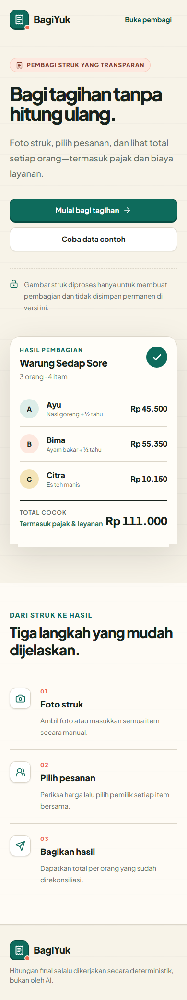
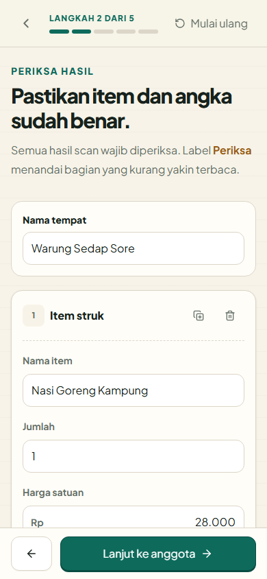
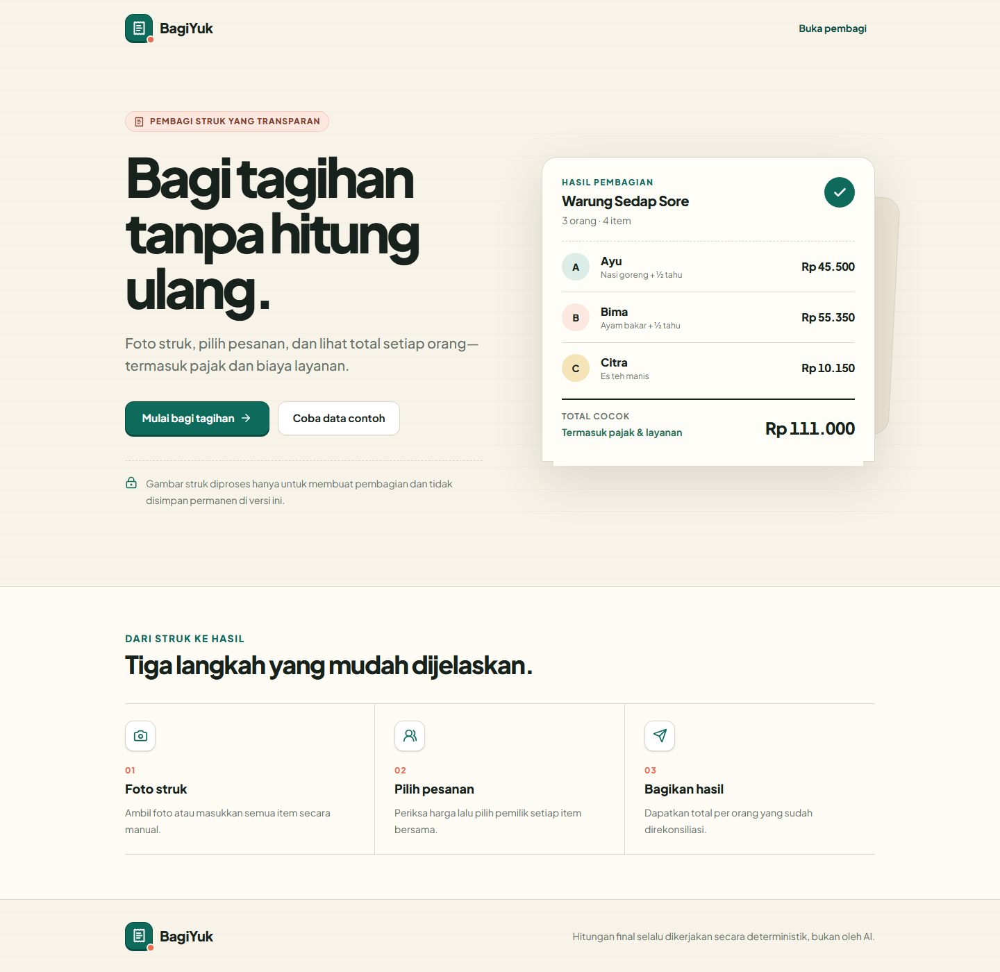

# BagiYuk

BagiYuk is a mobile-first Indonesian web app for splitting restaurant receipts by item. It supports shared items, proportional tax and service charges, discounts, signed rounding, exact integer-rupiah reconciliation, and shareable per-person results.

The core workflow remains fully usable without server OCR: **Struk → Periksa → Anggota → Bagikan → Hasil**. Receipt OCR is an optional, editable accelerator backed by a protected PP-OCRv6 Cloud Run service with an on-device PP-OCRv6 fallback.

## Features

- Camera/gallery receipt input with automatic scanning, photo-quality preflight, staged progress, in-memory review photo, cancel/retry, and manual fallback.
- Private CPU PP-OCRv6 service on Cloud Run plus on-device PaddleOCR.js/WebAssembly fallback.
- Turnstile, service-account-key-free Google Workload Identity Federation, private Cloud Run IAM, D1 quotas, anonymous keyed identifiers, strict image limits, and a global monthly dispatch cap.
- Zod-validated structured OCR output and visible low-confidence review states.
- Editable item names, quantity, unit price, line total, subtotal, tax, service, discount, rounding, and receipt total.
- Fast participant entry, deterministic avatars, and accessible multi-owner item assignment with optional weighted portions such as 2:1.
- Integer-only largest-remainder allocation for shared items and proportional charges.
- Explicit subtotal and final-total reconciliation; mismatches are never hidden.
- WhatsApp-readable Web Share output with clipboard fallback.
- Per-person WhatsApp messages, payer-to-group settlement instructions, print/PDF output, and a locally generated downloadable PNG summary.
- First-party, content-free product event counters with an optional Cloudflare Analytics Engine binding.
- Dedicated Help, Privacy, and browser Diagnostics pages plus branded error states and a respectful install prompt.
- Local JSON draft autosave, a homepage resume card, and a complete guided sample without persisting receipt images.
- Installable PWA manifest with generated PNG/maskable icons and an expanded offline shell for the manual workflow.
- Safe response headers, search metadata, print styles, and GitHub Actions quality gates.
- Responsive Warm Ledger UI with sticky mobile actions and reduced-motion support.

## Quick start

Requirements: Node.js 22+ and pnpm 11+.

```bash
pnpm install
pnpm dev
```

Open `http://localhost:3000`. Choose **Coba data contoh** for the fastest full journey. No credentials are required for local OCR or manual input; protected server OCR activates only after its infrastructure is configured.

## Commands

```bash
pnpm dev          # Next.js development server
pnpm typecheck    # strict TypeScript
pnpm lint         # ESLint and Next.js rules
pnpm test         # deterministic domain/provider unit tests
pnpm test:ocr-service # Python OCR response-mapping checks
pnpm test:e2e     # Playwright mobile and desktop journeys
pnpm benchmark:cord:fetch # cache CORD annotations + eight-image subset
pnpm benchmark:cord       # evaluate 800 annotated Indonesian receipts
pnpm screenshots  # refresh visual QA captures while dev server is running
pnpm assets:pwa   # regenerate PNG PWA icons from repository-owned SVG artwork
pnpm build        # Next.js production build
pnpm cf:build     # OpenNext build + Cloudflare asset pruning
pnpm preview      # OpenNext build + local Cloudflare workerd
pnpm deploy       # OpenNext build + Cloudflare Workers deploy
pnpm cf-typegen   # regenerate Cloudflare binding types
```

## Architecture

- `src/domain/billing` is the sole calculation authority. Money is a safe integer and all remainders have stable participant-order tie breaking.
- `src/features/splitter` owns the local reducer-compatible draft shape and persistence schema.
- `src/features/receipt-parser` prefers protected server OCR when configured, then falls back to PaddleOCR.js. Independent phase timeouts and delayed local-engine prewarming prevent a server cold start from consuming the fallback budget. Both paths feed the same deterministic, editable receipt parser.
- `services/receipt-ocr` is a private FastAPI/PP-OCRv6 CPU container. Cloudflare reaches it through short-lived federated Google identity tokens; it returns only text/confidence/polygons and never calculates a split.
- The Next.js App Router handles the homepage, wizard, manifest, and server parse route. OpenNext packages it for Cloudflare Workers.
- Base UI powers the accessible reset alert dialog; shadcn's `base-nova` configuration and local UI components keep the design system small.

See [implementation plan](docs/implementation-plan.md), [OCR boundary](docs/ai-usage.md), [CORD benchmark](docs/ocr-benchmark.md), [deployment](docs/deployment.md), and [pinned versions](docs/stack-versions.md).

## Screenshots

The main Playwright journey covers a 390×844 mobile viewport and desktop Chromium.







## Privacy and limitations

- Protected server OCR receives one metadata-free, compressed image (maximum 4 MiB) in memory and discards it after the request. Local fallback images never leave the device. Neither path persists receipt images.
- Draft JSON stays in the current browser's local storage; it does not sync across devices.
- The pretrained PP-OCRv6 model files are downloaded from PaddleOCR's official model host on first use and cached by the browser.
- OCR accuracy depends on image quality and must always be reviewed by the user.
- Remote OCR is limited persistently per anonymous device, network, and globally through Turnstile plus D1. Browser OCR and manual entry remain unlimited.
- The app intentionally has no login, payment transfer, POS integration, or permanent history.
